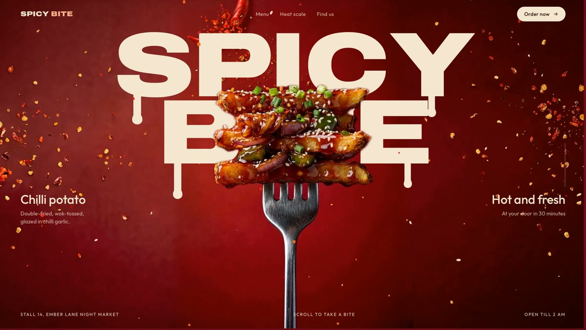
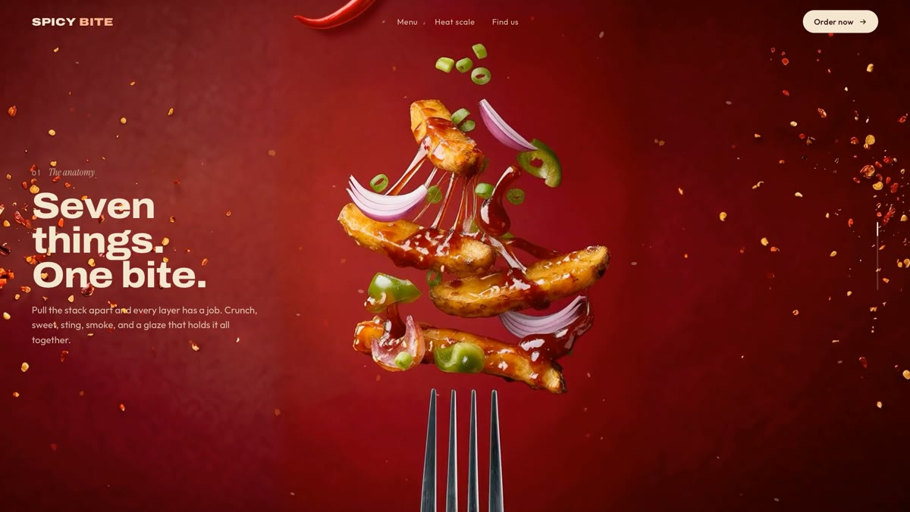

# Spicy Bite

A scroll-driven landing page for **Spicy Bite**, a fictional Indo-Chinese street kitchen.

**Live:** https://moh4696.github.io/spicy-bite/



Scroll down and one chilli potato comes apart into its ingredients, which get labelled. The pieces orbit like they are being tossed in a wok, then land in a black bowl. After that the page drips from crimson into a cream menu, then an interactive heat dial (Mild hum to Volcano) and a "find us" section.



## How it works

- Plain HTML, CSS and JS. No build step and no framework.
- The hero is a cleaned-up food poster. Three AI-generated video legs are scrubbed by scroll position: explode, orbit, bowl. Each leg starts on the exact last frame of the one before, so the seams don't show.
- The live "SPICY BITE" type sits behind a cutout of the fork and food, so the food overlaps the word.
- Ingredient labels are SVG, anchored in video space, so they track the footage at any viewport size.
- Chilli flakes and sesame are drawn on a canvas and move away from the cursor. The drip wipe and the ember heat dial are also code.
- Phones get lighter video files and a portrait layout.

## Run locally

```bash
python3 -m http.server 8000
```

Then open http://localhost:8000.

## Notes

Spicy Bite, its stall, menu and prices are made up. This is a concept site, not a real restaurant. The "order" flow is a demo and nothing is sent anywhere.

Built with Claude Opus 5.5 in Claude Code. See [PROMPT.md](PROMPT.md).
